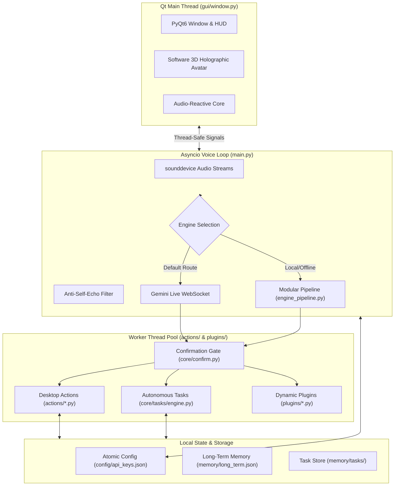

# openagent

[](https://github.com/Sanj1th-M/openagent/actions/workflows/ci.yml)
[](https://github.com/Sanj1th-M/openagent/actions/workflows/security.yml)
[](pyproject.toml)
[](#-attribution)

> **openagent** is an open-source, local-first multimodal personal AI assistant and autonomous desktop agent. It combines bidirectional real-time voice streaming, a software-rendered 3D holographic avatar, autonomous background task execution, verifiable desktop automation, and an encrypted remote control dashboard.

---

## 📑 Table of Contents

- [Overview](#-overview)
- [Key Capabilities](#-key-capabilities)
- [System Architecture](#-system-architecture)
- [Technology Stack](#-technology-stack)
- [Documentation Index](#-documentation-index)
- [Installation Quick Start](#-installation-quick-start)
- [Configuration Overview](#-configuration-overview)
- [Basic Usage](#-basic-usage)
- [Testing & Quality Assurance](#-testing--quality-assurance)
- [Contributing](#-contributing)
- [Security & Data Privacy](#-security--data-privacy)
- [Attribution & Maintainers](#-attribution)

---

## ✨ Overview

openagent operates on your terms with full cross-platform support across Windows, macOS, and Linux:

- **Autonomous Background Work**: Delegate multi-step research and workflows that continue in the background while your live voice session remains responsive.
- **Flexible Intelligence**: Seamlessly switch between Google Gemini Live multimodal streaming and fully local, offline modular pipelines (Whisper STT + OpenAI-compatible local models + Piper TTS).
- **Verifiable Automation**: Actions verify process state, window geometry, and system settings instead of assuming success from command exit codes.
- **Privacy & Defense-in-Depth**: Hardened against prompt injection with untrusted external content fencing, local credential storage, and human-in-the-loop gates for irreversible operations.
- **Customizable Identity**: The assistant display name is fully user-configurable (defaults to **Jarvis**).

---

## 🚀 Key Capabilities

| Capability | Description |
|---|---|
| 🎙️ **Real-Time Voice Streaming** | Ultra-low latency conversational audio streaming via Google Gemini Live API. |
| 🔌 **Modular Engine & Offline Mode** | Pluggable local speech pipeline using local Whisper STT, local/hosted LLMs (Ollama, LM Studio, vLLM), and Piper neural TTS across ~50 languages. |
| 🧑‍🎤 **Holographic Avatar & Reactor** | Real-time software-rendered 3D face mesh and depth-cued reactor core in PyQt6 with zero GPU or OpenGL dependencies. |
| 👄 **Phonetic Lip-Sync & Visemes** | Synchronized mouth articulation derived dynamically from real-time audio formants and speech transcripts. |
| 🧵 **Autonomous Task Engine** | Multi-round task scheduler with disk checkpoints, time budgets, round budgets, and crash resilience. |
| 🔬 **Fact-Checked Deep Research** | Autonomous web research agent that verifies citations directly against saved page source text in code. |
| 🗓️ **Unified Routine Engine** | Flexible voice-managed automation rules for morning briefings, timed check-ins, reminders, and background monitors. |
| 🔇 **Adaptive Anti-Self-Echo** | Continuous output-buffer subtraction preventing the assistant from triggering on its own spoken audio. |
| 🎚️ **Push-to-Talk & Wake Word** | Optional local offline wake-word detector ("Hey Jarvis") and customizable push-to-talk hotkey (`Ctrl+Space`). |
| 🖥️ **Desktop Automation Suite** | Verified application management, browser interaction, document reading, media playback, and hardware telemetry. |
| 📱 **Encrypted Mobile Dashboard** | Mobile/browser remote control authenticated via PBKDF2 (200k rounds) with TLS and AES-256-GCM encrypted transport. |
| ↩️ **Deterministic System Undo** | Reversible action journaling for file operations, desktop organization, and computer settings. |

---

## 📐 System Architecture

openagent enforces a strict separation of concerns across threading boundaries to guarantee responsive UI rendering, glitch-free audio processing, and safe tool execution:



For complete architectural details, see the [System Architecture Guide](docs/ARCHITECTURE.md) and [Architecture Diagrams](docs/diagrams/system-architecture.md).

---

## 🛠️ Technology Stack

- **Core Runtime**: Python 3.11+ (tested on Python 3.11, 3.12, 3.13)
- **Graphical Interface**: PyQt6, NumPy (3D software projection, zero GPU required)
- **Audio Processing**: SoundDevice, NumPy FFT viseme analyzer, PortAudio
- **Primary AI Provider**: Google GenAI SDK (`google-genai`), Gemini Live WebSockets
- **Modular AI Providers**: HTTPX, Whisper (`faster-whisper`), Piper TTS, ElevenLabs
- **Automation & System**: Playwright, PyAutoGUI, PSUtil, Send2Trash, PyWin32 (Windows)
- **Remote Dashboard**: FastAPI, Uvicorn, Cryptography (PBKDF2 / AES-256-GCM)
- **Code Quality & Security**: Ruff, Mypy, Pytest, Bandit, Pip-Audit, CodeQL

---

## 📚 Documentation Index

Comprehensive enterprise technical documentation is maintained in the `docs/` tree:

| Document | Description |
|---|---|
| 📐 [Architecture Specification](docs/ARCHITECTURE.md) | In-depth breakdown of system design, threading topology, and recovery flows |
| 📊 [System Architecture Diagram](docs/diagrams/system-architecture.md) | High-level component and subsystem architecture diagram |
| 🎙️ [Voice Pipeline Diagram](docs/diagrams/voice-pipeline.md) | End-to-end voice capture, anti-echo, and viseme generation sequence |
| 🔀 [Provider Flow Diagram](docs/diagrams/provider-flow.md) | Provider fallback ladder, modular engine routing, and tool loop guards |
| 🛠️ [Installation Guide](docs/INSTALLATION.md) | System requirements, OS package setup, and step-by-step installation |
| ⚙️ [Configuration Guide](docs/CONFIGURATION.md) | Configuration keys, environment variables, and credential management |
| 🔌 [API & Interfaces](docs/API.md) | Base provider contracts, plugin definitions, and dashboard endpoints |
| 🛡️ [Security Architecture](docs/SECURITY.md) | Threat boundaries, prompt fencing, confirmation gates, and TLS/AES ciphers |
| 🧪 [Testing Guide](docs/TESTING.md) | Unit testing, provider tests, static analysis, security scanning, and CI |
| 🚀 [Deployment & Packaging](docs/DEPLOYMENT.md) | Sdist/wheel packaging, releases, and headless server deployment |
| 💻 [Coding Standards](docs/development/CODING_STANDARDS.md) | Python standards, thread-safety rules, and defensive coding practices |
| 📦 [Release Process](docs/development/RELEASE_PROCESS.md) | Versioning strategy, release checklists, and tag-triggered automation |
| 🤝 [Contributing Guidelines](CONTRIBUTING.md) | Contribution lifecycle, Git branching, and pull request requirements |
| 📝 [Changelog](CHANGELOG.md) | Release history maintained following Keep a Changelog standards |

---

## ⚡ Installation Quick Start

### 1. Clone the Repository
```bash
git clone https://github.com/Sanj1th-M/openagent.git
cd openagent
```

### 2. Set Up a Virtual Environment
```bash
# macOS / Linux
python3 -m venv .venv
source .venv/bin/activate

# Windows (PowerShell)
python -m venv .venv
.\.venv\Scripts\Activate.ps1
```

### 3. Run the OS-Aware Setup Installer
`setup.py` detects your operating system, applies platform dependency filters, and installs required browser binaries:
```bash
python setup.py
```

### 4. Launch the Application
```bash
python main.py
```

*For detailed platform instructions and prerequisite system libraries, refer to [INSTALLATION.md](docs/INSTALLATION.md).*

---

## ⚙️ Configuration Overview

All configuration is stored locally and atomically in `config/api_keys.json` (strictly git-ignored).

On first startup, the GUI prompts for your **Google Gemini API Key** (obtainable from [Google AI Studio](https://aistudio.google.com/)).

Key settings can be updated at any time via the GUI settings drawer (⚙) or edited programmatically via `memory/config_manager.py`:

```json
{
  "gemini_api_key": "YOUR_GEMINI_API_KEY",
  "local_only": false,
  "assistant_name": "Jarvis",
  "wake_word_enabled": false,
  "wake_word": "hey jarvis",
  "audio_input_device": null,
  "audio_output_device": null,
  "providers": {
    "active_llm": "gemini",
    "active_stt": "whisper_local",
    "active_tts": "system"
  }
}
```

*For full configuration schemas and local provider setups, consult [CONFIGURATION.md](docs/CONFIGURATION.md).*

---

## 🎯 Basic Usage

- **Live Voice Interaction**: Speak directly into your microphone. The assistant streams audio responses while animating facial visemes in real time.
- **Push-to-Talk**: Hold `Ctrl+Space` to transmit; release to close the audio capture channel.
- **Local Wake Word**: Toggle **Wake Word** under ⚙ → WAKE WORD to enable hands-free local activation via `"Hey Jarvis"`.
- **Autonomous Research**: Say *"Research budget 3D printers for ten minutes"* — the assistant acknowledges immediately and compiles a cited markdown report in `reports/`.
- **Desktop Actions**: Ask to open applications, control volume/brightness, read local documents, or search the web.
- **System Undo**: Say *"Undo"* in any language to reverse recent file manipulations, desktop organization, or settings changes.
- **Action Confirmation**: Destructive operations (power controls, network disconnects) trigger a HUD confirmation banner requiring user confirmation.

---

## 🧪 Testing & Quality Assurance

Run the automated test suite locally:

```bash
# Unit tests
python -m pytest tests/ -v

# Provider integration tests
python -m providers._tests

# Code style and linting
ruff check tests/ setup.py
ruff format --check tests/ setup.py

# Type checking
mypy tests/

# Security AST scan
bandit -ll -r actions core gui memory plugins main.py ui.py setup.py tests
```

*For headless execution, CI matrix configurations, and dependency auditing, review [TESTING.md](docs/TESTING.md).*

---

## 🤝 Contributing

Contributions are welcomed! Please follow these core principles:
1. **Thread Safety**: Never touch Qt GUI widgets from worker threads. Always use `player` bridge methods.
2. **Defensive Coding**: Wrap plugin code in `try/except` and fence untrusted web data.
3. **Quality Gates**: Ensure Ruff linting, Mypy checks, and Pytest suites pass before opening PRs.

Review the [Contributing Guidelines](CONTRIBUTING.md) and [Coding Standards](docs/development/CODING_STANDARDS.md) for details on Git conventions and review standards.

---

## 🔒 Security & Data Privacy

openagent is architected with strict local-first data privacy:
- **No Telemetry**: Zero external tracking, accounts, or proprietary analytics servers.
- **Local Storage**: Credentials, conversation memory (`memory/long_term.json`), and task checkpoints stay exclusively on your filesystem.
- **Encrypted Remote Access**: Mobile dashboard communication uses TLS and AES-256-GCM payload encryption with PBKDF2 key derivation.
- **Prompt Injection Defense**: External web data is isolated using `<<<UNTRUSTED ...>>>` fences.
- **Process Protection**: The assistant detects and shields its own process tree from self-termination commands.

To report security vulnerabilities, consult our [Security Policy](docs/SECURITY.md).

---

## 👤 Project Maintainer

Maintained and adapted by **Sanj1th**.

