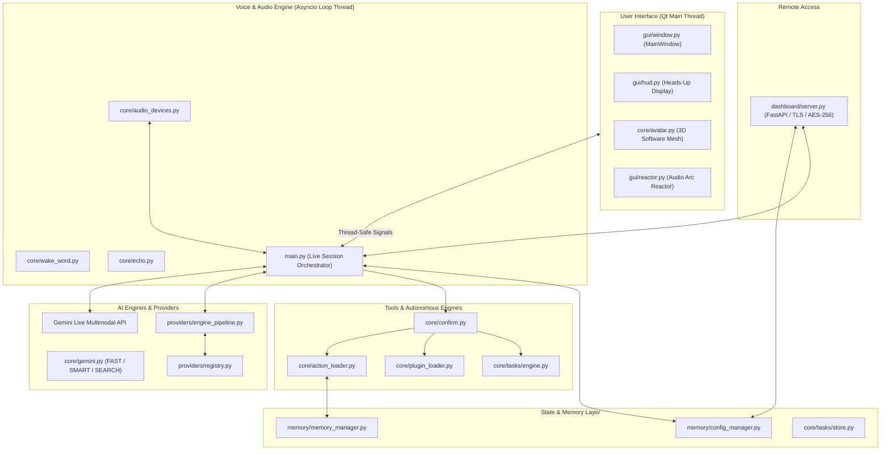
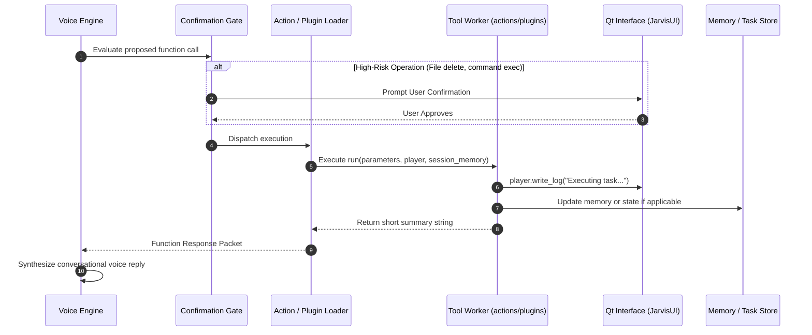

# Architecture & Technical Design

## 1. Project Overview

**openagent** is an open-source, local-first, multimodal voice assistant and autonomous desktop agent. It combines real-time bidirectional voice conversation, a software-rendered 3D holographic avatar, system-level automation tools, extensible plugins, persistent long-term memory, an autonomous background task engine, and an encrypted remote web/mobile dashboard.

The project is architected with a strict separation of concerns across threading boundaries:
- **GUI Main Thread**: Hosts the PyQt6 event loop, rendering holographic frames, activity feeds, dials, meters, and user configuration drawers.
- **Asyncio Voice Loop Thread**: Maintains the low-latency WebSocket connection to Gemini Live or runs the local audio processing pipeline.
- **Worker Thread Pool**: Executes long-running tasks, tool invocations, and plugin operations safely isolated from Qt widgets and real-time audio loops.

---

## 2. System Architecture

---

## 3. Application Entry Points

1. **`main.py`**:
   - The primary entry point.
   - Initializes logging, checks dependencies, verifies platform support (`core/platform_support.py`), validates audio devices, loads saved configuration from `memory/config_manager.py`, and initializes the PyQt6 application.
   - Spawns the voice pipeline in an asynchronous worker thread (`asyncio.run(_voice_main(...))`) while running the Qt GUI main event loop (`app.exec()`).
2. **`ui.py`**:
   - Manages the GUI application lifecycle and re-exports core UI classes (`JarvisUI`, `MainWindow`).
   - Acts as the thread-safe bridge between background workers and the Qt interface.
3. **`setup.py`**:
   - Cross-platform setup and dependency installer.
   - Inspects the operating system (`Windows`, `Darwin`, `Linux`), verifies Python versions (3.11 - 3.13), filters platform-specific dependencies, and installs browser binaries for Playwright.
4. **`dashboard/server.py`**:
   - Lightweight standalone or embedded FastAPI web server providing remote control from mobile devices or local network browsers.

---

## 4. Core Components & Responsibilities

| Component | File Path | Responsibilities |
|---|---|---|
| **App Identity** | `core/appidentity.py` | Detects running system processes, ranks matched application names, normalizes titles, and guarantees the assistant never targets its own processes. |
| **Audio Devices** | `core/audio_devices.py` | Enumerates and tests system microphones and speakers via `sounddevice`, ensuring valid sample rates (16kHz / 24kHz / 48kHz). |
| **Avatar Engine** | `core/avatar.py` & `core/avatar_mesh.py` | Renders a 3D holographic wireframe mesh directly with software rasterization (`numpy` + `QPainter`), requiring zero GPU or OpenGL dependencies. |
| **Echo Guard** | `core/echo.py` | Maintains a circular buffer of assistant speech output to dynamically filter self-echo out of input microphone streams. |
| **Gemini Client** | `core/gemini.py` | Manages one-shot structured queries across a fallback ladder (`FAST`, `SMART`, `SEARCH`), avoiding quota deadlocks by using ephemeral sessions. |
| **Confirmation Gate** | `core/confirm.py` | Intercepts potentially dangerous actions (deleting files, terminal execution, system shutdowns) and requests explicit user confirmation. |
| **Task Engine** | `core/tasks/engine.py` | Autonomous multi-turn task worker supporting checkpoints, time and round budgets, automatic quota retries, and background execution. |
| **Config Manager** | `memory/config_manager.py` | Thread-safe, atomic configuration read/write for `config/api_keys.json` with automatic backup recovery on corruptions. |

---

## 5. Voice Processing Architecture

The voice architecture supports dual execution pathways:

### 1. Default Route: Google Gemini Live API
- Uses the `google-genai` SDK WebSocket interface (`client.aio.live.connect`).
- Bidirectional streaming: Raw 16kHz PCM audio frames are pushed continuously to the server.
- The server determines turn end (Voice Activity Detection), emits audio chunks in real-time, provides synchronized output transcription, and requests client-side function calls.

### 2. Local/Modular Route: `providers/engine_pipeline.py`
- Emulates the Gemini Live interface when offline, running local models, or when Gemini API quota is depleted.
- Employs local energy/silence VAD (`_VAD_SILENCE_MS = 700ms`, `_VAD_FLOOR_MARGIN = 3.5x` noise floor).
- Executes sequential stages:
  1. **STT**: Transcribes buffered audio via `providers/stt_whisper.py`.
  2. **LLM**: Submits chat context to an OpenAI-compatible endpoint via `providers/llm_openai.py`.
  3. **TTS**: Synthesizes the generated response via Piper (`providers/tts_piper.py`), ElevenLabs (`providers/tts_elevenlabs.py`), or native OS voice (`providers/tts_system.py`).
  4. **Loop Protection**: Detects and breaks infinite tool-calling loops if a model hallucinates repeat tool invocations.

---

## 6. Threading and Asynchronous Execution

To prevent GUI freezing, audio stuttering, or race conditions, openagent enforces a strict three-tier threading discipline:

```mermaid
graph LR
    subgraph MainThread ["Thread 1: Qt Main Thread"]
        GUIEventLoop["PyQt6 Event Loop"]
        WindowPaint["Avatar & HUD Paint Events"]
        Drawers["Settings & Dialogs"]
    end

    subgraph VoiceThread ["Thread 2: Asyncio Voice Loop"]
        EventLoop["asyncio Event Loop"]
        LiveWS["Gemini Live WebSocket Stream"]
        AudioCapture["sounddevice InputStream Callback"]
    end

    subgraph WorkerPool ["Thread Pool / Background Workers"]
        ToolsExec["actions/*.py & plugins/*.py"]
        AutonomousTasks["core/tasks/engine.py"]
        WebDashboardThread["uvicorn HTTP/WebSocket Server"]
    end

    VoiceThread -->|pyqtSignal emit| MainThread
    WorkerPool -->|pyqtSignal emit via player| MainThread
    VoiceThread -->|Spawns Worker| WorkerPool
```

### Threading Rules:
1. **Never touch Qt widgets from worker threads**: Code in `actions/` and `plugins/` must never instantiate or modify `QWidget`, `QDialog`, or `QApplication`.
2. **Use thread-safe player dispatchers**: Tools must invoke thread-safe bridge methods on `player` (`player.write_log()`, `player.show_content()`, `player.show_quiz()`, `player.show_review()`, `player.show_video()`).
3. **Non-blocking asynchronous loops**: Network operations and long tool tasks must run inside `threading.Thread` or worker pools to prevent blocking audio packet streaming.

---

## 7. Data Flow & Action Execution Lifecycle

---

## 8. Error Handling and Recovery

- **Atomic Config Serialization**: `memory/config_manager.py` writes changes to `.tmp` files before renaming, preventing partial-write file corruption during sudden shutdowns. Corrupt files are backed up to `.broken-<timestamp>` rather than discarded.
- **Provider Fallback Ladder**: `core/gemini.py` falls back through ephemeral Live sessions, pinned REST models, and rolling alias endpoints when deadlines or HTTP 429 quota exhaustion occur.
- **Plugin Sandboxing**: Every dynamic plugin execution in `core/plugin_loader.py` is wrapped in exception handlers; a crashing plugin returns an explanatory error sentence rather than crashing the assistant.
- **Task Resilience**: Background autonomous tasks in `core/tasks/engine.py` save round checkpoints to disk (`core/tasks/store.py`). Tasks resume from the last completed round upon system restart.
