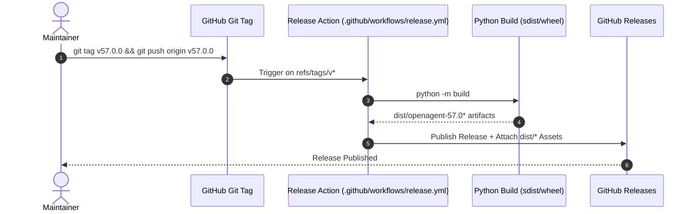

# Deployment & Distribution Guide

This document describes packaging, distribution artifacts, release workflows, and deployment procedures for **openagent**.

---

## 1. Application Packaging Architecture

openagent is distributed as a standard Python package with source distributions (`.tar.gz`) and platform-independent wheels (`.whl`), packaged using standard PEP 517/518 build tooling.

### Packaging Configuration (`pyproject.toml` & `setup.py`)
- **Build Backend**: `setuptools.build_meta`
- **Included Packages**: `gui`, `core`, `memory`, `actions`, `plugins`, `providers`
- **Modules**: `main`, `ui`, `setup`
- **Python Requirement**: `>=3.11`

---

## 2. Building Distribution Artifacts

To create release packages locally:

```bash
# Install packaging tools
python -m pip install --upgrade pip build wheel setuptools

# Build source distribution and binary wheel
python -m build
```

This generates:
- `dist/openagent-<version>.tar.gz` (Source distribution)
- `dist/openagent-<version>-py3-none-any.whl` (Wheel distribution)

---

## 3. Automated CI/CD Release Workflow

Releases are automated via GitHub Actions in `.github/workflows/release.yml`:



---

## 4. Local Deployment & Running

### Desktop Deployment
1. **Clone & Setup**:
   ```bash
   git clone https://github.com/Sanj1th-M/openagent.git
   cd openagent
   python setup.py
   ```
2. **Execute**:
   ```bash
   python main.py
   ```

### Headless or Remote Server Deployment (Dashboard Mode)
If deploying on a local home server or headless desktop machine to serve the remote mobile dashboard:

> [!IMPORTANT]
> **Headless Initial Setup Prerequisite**: On a fresh installation, `main.py` checks `config/api_keys.json` for `os_system` and a valid engine configuration (`gemini_api_key`, `local_only: true`, or `providers.mode: "pipeline"`). If absent, `main.py` displays a graphical `SetupOverlay` and pauses startup at `ui.wait_for_api_key()`. In offscreen mode (`QT_QPA_PLATFORM=offscreen`), this overlay cannot be interacted with, which prevents `DashboardServer.serve()` from starting.
>
> To deploy in headless mode, you must satisfy the initial configuration prerequisite before launching offscreen:
> 1. **Option A (Pre-configured JSON)**: Create or edit `config/api_keys.json` with `"os_system": "linux"` (or `"windows"` / `"darwin"`) and your engine preference (e.g. `"local_only": true` or `"gemini_api_key": "YOUR_KEY"`).
> 2. **Option B (Desktop Setup First)**: Run `python main.py` once with an active display and complete the initial setup dialog before moving the configuration to the headless host. This satisfies the startup configuration check only; it does not create a persistent dashboard pairing PIN.

> [!WARNING]
> **Headless pairing is not currently supported.** A new pairing PIN is created in memory by `DashboardServer.new_key()` when the desktop Remote Control UI requests one. Pending PINs are not stored in `config/api_keys.json`, and the server exposes no headless CLI/API operation to create one. Therefore, a fully offscreen instance can start after it has been configured, but a new phone cannot be paired from that headless instance. Completing desktop setup and then restarting in offscreen mode does not carry a pairing PIN across the restart. Use the dashboard pairing flow from an accessible desktop UI; do not assume preconfiguring the JSON file enables headless pairing.

Once configured, run openagent in offscreen mode:
```bash
export QT_QPA_PLATFORM=offscreen
python main.py
```

#### Dashboard Protocol & TLS Behavior
- **Default (Plain HTTP)**: When `"dashboard_https"` is unset or `false` in `config/api_keys.json`, `DashboardServer.serve()` starts on **plain HTTP on port 8000**. Network traffic is unencrypted (though authentication remains gated by the pairing code).
- **Enabling HTTPS**: Set `"dashboard_https": true` in `config/api_keys.json` (and ensure `cryptography` is installed). The server automatically generates a self-signed TLS certificate in `config/certs/`, serves HTTPS on port 8001, and runs an HTTP-to-HTTPS redirector on port 8000. Clients must accept the self-signed certificate once per device.
- **Certificate Fallback**: If certificate generation fails (e.g. `cryptography` is missing or directory creation fails), the server logs a warning and falls back to plain HTTP on port 8000 rather than aborting.

---

## 5. Rollback & Upgrade Procedures

### Upgrading
```bash
git fetch --all --tags
git checkout <new_release_tag>
python -m pip install -r requirements.txt
python -m playwright install chromium firefox
```

### Rollback
If a version introduces incompatibility on your workstation:
```bash
git checkout <previous_stable_tag>

# Deactivate the active virtual environment before removal to prevent shell path lookup errors
# macOS / Linux
deactivate 2>/dev/null || true
rm -rf .venv
python3 -m venv .venv
source .venv/bin/activate

# Windows (PowerShell)
# deactivate
# Remove-Item -Recurse -Force .venv
# python -m venv .venv
# .\.venv\Scripts\Activate.ps1
# python -m pip install -r requirements.txt
# python -m playwright install chromium firefox

# The commands above restore dependencies from the checked-out tag.
```
Configuration files (`config/api_keys.json`) remain backward-compatible; if an incompatible setting exists, `memory/config_manager.py` ignores unmapped keys gracefully.
