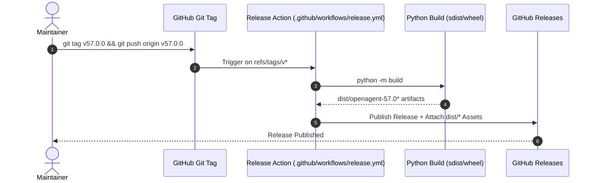

# Deployment & Distribution Guide

This document describes packaging, distribution artifacts, release workflows, and deployment procedures for **openagent**.

---

## 1. Application Packaging Architecture

openagent is distributed as a standard Python package with source distributions (`.tar.gz`) and platform-independent wheels (`.whl`), packaged using standard PEP 517/518 build tooling.

### Packaging Configuration (`pyproject.toml` & `setup.py`)
- **Build Backend**: `setuptools.build_meta`
- **Included Packages**: `gui`, `core`, `memory`, `actions`, `plugins`, `providers`
- **Modules**: `main`, `ui`, `setup`
- **Python Requirement**: `>=3.11`

---

## 2. Building Distribution Artifacts

To create release packages locally:

```bash
# Install packaging tools
python -m pip install --upgrade pip build wheel setuptools

# Build source distribution and binary wheel
python -m build
```

This generates:
- `dist/openagent-<version>.tar.gz` (Source distribution)
- `dist/openagent-<version>-py3-none-any.whl` (Wheel distribution)

---

## 3. Automated CI/CD Release Workflow

Releases are automated via GitHub Actions in `.github/workflows/release.yml`:



---

## 4. Local Deployment & Running

### Desktop Deployment
1. **Clone & Setup**:
   ```bash
   git clone https://github.com/Sanj1th-M/openagent.git
   cd openagent
   python setup.py
   ```
2. **Execute**:
   ```bash
   python main.py
   ```

### Headless or Remote Server Deployment (Dashboard Mode)
If deploying on a local home server or headless desktop machine to serve the remote mobile dashboard:
```bash
# Run in offscreen mode
export QT_QPA_PLATFORM=offscreen
python main.py
```
Or run the dashboard independently:
```bash
python -m uvicorn dashboard.server:app --host 0.0.0.0 --port 8000
```

---

## 5. Rollback & Upgrade Procedures

### Upgrading
```bash
git fetch --all --tags
git checkout <new_release_tag>
python -m pip install -r requirements.txt
python -m playwright install chromium firefox
```

### Rollback
If a version introduces incompatibility on your workstation:
```bash
git checkout <previous_stable_tag>
```
Configuration files (`config/api_keys.json`) remain backward-compatible; if an incompatible setting exists, `memory/config_manager.py` ignores unmapped keys gracefully.
