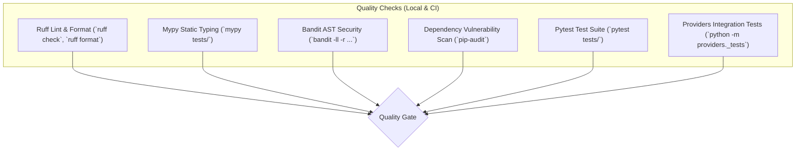

# Testing Guide

This document details the test architecture, automated suites, continuous integration workflows, and manual verification procedures for **openagent**.

---

## 1. Testing Architecture

openagent employs automated unit testing, integration tests, static code analysis, security scanning, and headless GUI execution.



---

## 2. Running Local Automated Tests

### A. Environment Preparation
Ensure your virtual environment is active and project dependencies are installed:
```bash
# Activate virtual environment
source .venv/bin/activate       # macOS / Linux
.\.venv\Scripts\Activate.ps1    # Windows

# Install testing requirements
pip install pytest ruff mypy bandit pip-audit
```

### B. Unit & Integration Tests (Pytest)
Execute unit test suites:
```bash
python -m pytest tests/ -v
```

For headless environments (e.g., Linux without an active display server):
```bash
QT_QPA_PLATFORM=offscreen python -m pytest tests/ -v
```

### C. Provider Integration Tests
Run provider-level functional tests:
```bash
python -m providers._tests
```

---

## 3. Code Quality & Linting Checks

Configured in `pyproject.toml` (`[tool.ruff]`, `[tool.mypy]`):

### Ruff Linting
Checks code style, imports, and syntax rules:
```bash
ruff check tests/ setup.py
ruff format --check tests/ setup.py
```

### Mypy Type Checking
Performs static type analysis:
```bash
mypy tests/
```

---

## 4. Security Scanning

### Bandit AST Security Scan
Scans Python abstract syntax trees for common security pitfalls and vulnerabilities:
```bash
bandit -ll -r actions core gui memory plugins main.py ui.py setup.py tests
```

### Dependency Vulnerability Audit
Audits installed packages against known CVE vulnerability advisories:
```bash
pip-audit -r requirements.txt
```

---

## 5. Continuous Integration (GitHub Actions)

The repository runs automated workflows defined in `.github/workflows/`:

1. **`ci.yml`**:
   - **Quality Job**: Runs Ruff linting, Ruff formatting checks, and Mypy on Python 3.12.
   - **Security Job**: Executes Bandit scanning and `pip-audit`.
   - **Matrix Test Suite**: Runs Pytest and provider integration tests across:
     - Operating Systems: `ubuntu-latest`, `windows-latest`, `macos-latest`
     - Python Versions: `3.11`, `3.12`
   - **Build Validation**: Tests source distribution builds (`python -m build --sdist`) and syntax checks `setup.py`.
2. **`security.yml`**:
   - Scheduled weekly scans running Bandit, `pip-audit`, and GitHub CodeQL static analysis.

---

## 6. Manual Verification Procedures

Before submitting changes, perform these smoke tests:
1. **Audio Verification**: Launch `main.py` and speak a query to confirm microphone input capture, waveform animation, and speaker output.
2. **GUI Interaction**: Open the settings drawer, change themes, and verify widget repainting without Qt thread violations.
3. **Tool Invocations**: Trigger a harmless desktop automation action (e.g., "What time is it?" or "Search web for openagent") to verify tool execution.
4. **Offline Fallback**: Disconnect network or configure an invalid Gemini key to verify seamless transition to `providers/engine_pipeline.py`.
